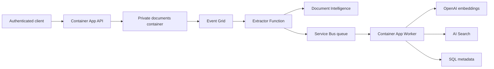

# Architecture overview

Baseline: 22 October 2026. This describes the implemented development system,
not a production-readiness certification.

## Purpose and architectural style

DocIntake accepts authenticated documents and asynchronously converts them into
searchable text chunks, embeddings, and SQL metadata. Independently deployed
API, Extractor, and Worker components communicate through Blob Storage events
and Service Bus rather than a long-running upload request.

## Technology and hosting

| Layer | Technology | Deployment |
|---|---|---|
| Upload API | C#, .NET 8, ASP.NET Core minimal APIs | Azure Container Apps, Docker |
| Extraction | .NET 8 isolated Azure Functions v4 | Flex Consumption FC1, ZIP package |
| Ingestion Worker | .NET 8 BackgroundService | Azure Container Apps, Docker |
| Contracts | C# shared records | Referenced project library |
| Events/messaging | BlobCreated events and JSON messages | Event Grid and Service Bus Standard |
| AI processing | prebuilt-read and text-embedding-3-small | Document Intelligence and Azure OpenAI |
| Persistence | Original documents, vector chunks, metadata | Blob Storage, AI Search, Azure SQL |
| Observability | Azure Monitor, Application Insights, OpenTelemetry | Log Analytics-backed telemetry |
| Delivery | Bicep, Bash, Azure CLI, Docker, Azure DevOps | Ubuntu hosted pipeline agent |

## Infrastructure shape

- API: HTTPS ingress on port 8080, 1-3 replicas outside bootstrap.
- Worker: no ingress, 0-5 replicas driven by queue depth through KEDA.
- Both Container Apps request 0.5 CPU and 1 GiB per replica.
- Extractor: 2048 MiB Flex instances, maximum 40, no always-ready configuration.
- Service Bus: Standard queue with duplicate detection and dead-lettering.
- AI Search: Basic, one replica and one partition; HNSW vectors, 1536 dimensions.
- SQL: Basic database; SQL location/name independently configurable.
- Public service endpoints and the opt-in Azure-services SQL rule are current
  development choices, not private production networking.

## Key decisions and trade-offs

Asynchronous processing keeps upload latency independent of extraction and
indexing, but requires operational visibility into retries and dead letters.
Search is written before SQL; there is no cross-service transaction.
Managed identity separates application authorization from deployment rights.
The Worker has a separate image-pull identity to avoid first-deployment RBAC
ordering problems.

The current inline-text message contract limits document size. The optional
chat endpoint is present, but retrieval/answer generation is incomplete and
chat is disabled in development.

## Related material

- [Component design](component-design.md)
- [Data flow and contracts](data-flow.md)
- [Security boundaries](security.md)
- [System context](system-context.md)
- [Azure resource inventory and deployment evidence](../development/deployment-verification.md)
- [Bicep source of truth](../../infra/main.bicep)
