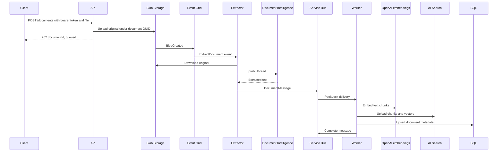

# Data flow

Baseline: 22 October 2026. Processing is asynchronous and at-least-once;
HTTP acceptance must not be presented as completed indexing.

## Ingestion sequence

## Data shapes and identifiers

| Stage | Representation |
|---|---|
| Upload response | `documentId` GUID and `status: queued` |
| Original blob | `documents/<guid>/<sanitized-file-name>` |
| Event | BlobCreated URL; documents-container subject filter |
| Queue body | JSON `sourceUrl`, `documentId`, `content` |
| Queue identity | MessageId equals document GUID |
| Search key | `<guid>-<zero-based-chunk-index>` |
| SQL key | Original GUID as `Id` |

Chunking uses 800 characters with 100-character overlap. Embeddings use
1536 dimensions. The Search `source` field is filterable and stores the original
blob URL. SQL stores metadata, not original bytes or extracted text.

## Retry and consistency boundaries

- Event Grid retries can rerun extraction and incur additional AI processing.
- Queue duplicate detection uses a 10-minute window; it is not permanent
  deduplication and can suppress an unchanged-ID manual replay within the window.
- The Worker renews locks, retries failures through abandonment, and dead-letters
  repeated failures with reason/description.
- Search upserts deterministic IDs; SQL upserts the document key. Same-document
  replay is designed to converge without duplicate rows/chunk IDs.
- SQL failure after Search upload leaves partial cross-store completion.
- Empty-text processing is skipped, so absence of a SQL row can indicate no
  text, not necessarily a queue failure.

Event Grid dead letters live in Blob Storage. Service Bus dead letters live
in its queue subqueue. Neither should be silently discarded during recovery.

## Known data-volume constraint

The queue contains inline text. Service Bus Standard has a 256 KB message limit
including overhead; batch admission can reject extracted content regardless of
the original PDF's file size.

Proposed, not implemented: store extracted text privately and send a blob
reference (claim-check pattern), with validated references, identity access,
retention, replay compatibility, and contract tests.

See [component design](component-design.md),
[verification procedures](../development/testing-strategy.md), and
[feature roadmap](../product/feature-roadmap.md).
