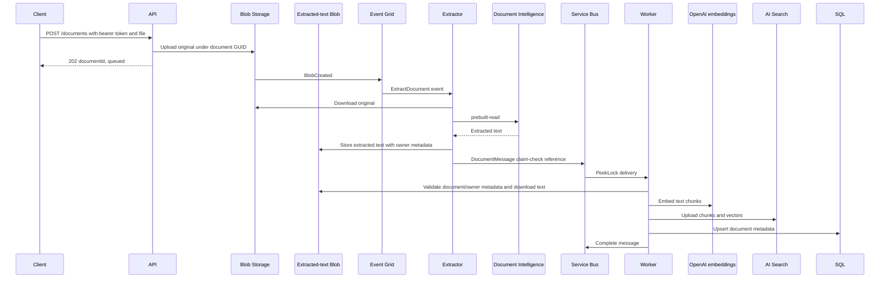

# Data flow

Baseline: 22 October 2026. Processing is asynchronous and at-least-once;
HTTP acceptance must not be presented as completed indexing.

## Ingestion sequence

## Data shapes and identifiers

| Stage | Representation |
|---|---|
| Upload response | `documentId` GUID and `status: queued` |
| Original blob | `documents/<guid>/<sanitized-file-name>` with owner and creation metadata |
| Event | BlobCreated URL; documents-container subject filter |
| Extracted text | `extracted-text/<guid>/content.txt`, private Blob with document/owner metadata |
| Queue body | JSON source, document ID, owner ID, creation time, original blob name, and extracted-text reference |
| Queue identity | MessageId equals document GUID |
| Search key | `<guid>-<zero-based-chunk-index>` with owner ID and deletion marker |
| SQL key | Original GUID as `Id`, with owner and lifecycle timestamps |

Chunking uses 800 characters with 100-character overlap. Embeddings use
1536 dimensions. The Search `source` field is filterable and stores the original
blob URL. SQL stores metadata, not original bytes or extracted text. Owner ID
comes from the authenticated Entra `oid` claim; lifecycle API operations scope
database reads and writes to that owner.

## Retry and consistency boundaries

- Event Grid retries can rerun extraction and incur additional AI processing.
- Queue duplicate detection uses a 10-minute window; it is not permanent
  deduplication and can suppress an unchanged-ID manual replay within the window.
- The Worker renews locks, retries failures through abandonment, and dead-letters
  repeated failures with reason/description.
- Search upserts deterministic IDs; SQL upserts the document key. Same-document
  replay is designed to converge without duplicate rows/chunk IDs.
- SQL failure after Search upload leaves partial cross-store completion.
- Empty-text processing is skipped, so absence of an indexed SQL row can
  indicate no text, not necessarily a queue failure.
- Owner deletion hides Search chunks, soft-deletes both blobs, and sets a
  30-day recovery deadline. The owner may restore within that window.
- The Worker runs a configurable hourly sweep; at 90-day expiry it soft-deletes
  blobs and purges Search/SQL metadata. Blob soft-delete remains for up to 30
  days, but the application restore window has expired. This is not backup or
  disaster recovery.

Event Grid dead letters live in Blob Storage. Service Bus dead letters live
in its queue subqueue. Neither should be silently discarded during recovery.

## Claim-check boundaries

The queue now contains only a validated extracted-text Blob reference rather
than the extracted text itself. The Worker enforces the document-specific blob
path and verifies document and owner metadata before downloading. Large-document
processing has automated contract coverage but has not yet been live-tested.

See [component design](component-design.md),
[verification procedures](../development/testing-strategy.md), and
[feature roadmap](../product/feature-roadmap.md).
