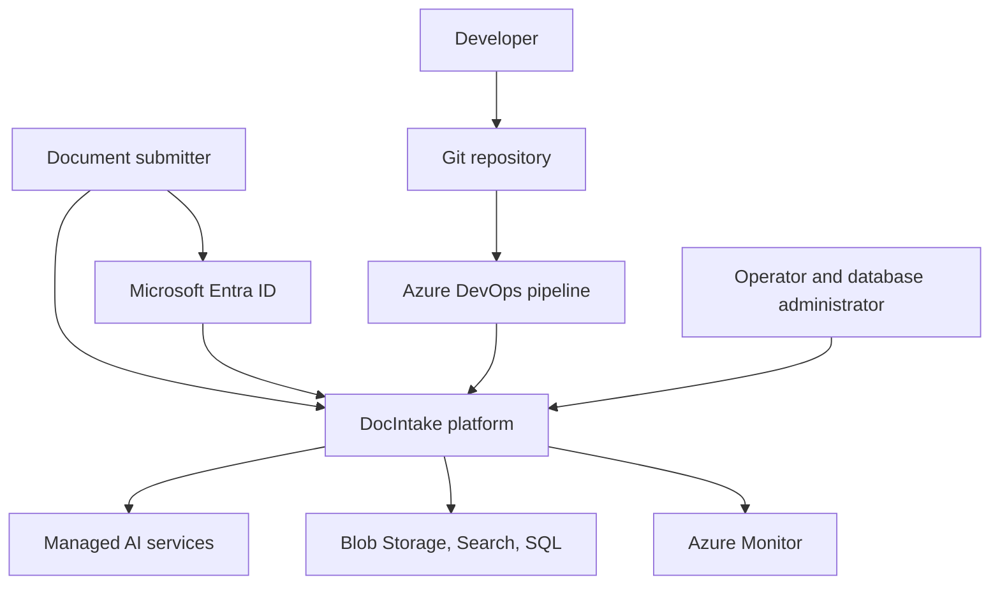

# System context

Baseline: 22 October 2026.

## Actors and responsibilities

| Actor | Interaction | Boundary |
|---|---|---|
| Document submitter | Obtain Entra token and upload PDF/DOCX | Public authenticated API |
| Operator | Inspect telemetry, queues, dead letters, Search, SQL | Azure management plus data-plane permissions |
| Database administrator | Create schema/users, maintain Entra administrator | SQL database and server configuration |
| Developer | Change code, run tests, prepare releases | Git repository and development services |
| Deployment identity | Provision resources and publish packages/images | Azure DevOps service connection |

No dedicated end-user web UI is implemented. Tests have used Cloud Shell/curl
and Azure Portal tools.

## External dependencies

The platform relies on Entra app registration/consent, Azure service quotas,
regional provisioning availability, an Azure DevOps service connection, and
public Azure service endpoints in the current development configuration.
Local Azurite does not generate Event Grid events; a local API test does not
validate the deployed ingestion chain.

## Environment boundaries

The current resource group is `rg-ai200-doc-intake-dev`. SQL is explicitly
configured in West US 3 with an overridden server name; other locations follow
their configured defaults/overrides. Development settings include chat off,
local Worker role grants off, and the prior deployed version's Azure-services
SQL firewall opt-in.

The repository now targets private SQL networking, but that Bicep change is not
deployed; the existing Azure environment should not be assumed to have private
SQL access. No separate production deployment, disaster-recovery environment,
or approved service-level objective is established. The resource inventory is
in the [deployment report](../development/deployment-verification.md).

## Scope

Implemented code scope includes authenticated asynchronous intake, extraction,
embedding, indexing, metadata persistence, owner-scoped document lifecycle
operations, claim-check messaging, and retention/deletion automation. The
blocker changes remain undeployed and unverified in Azure. Human review
workflows, production operations, backup/disaster recovery, and complete
question answering are not established.

See [architecture overview](architecture-overview.md) and
[product requirements](../product/product-requirement.md).
