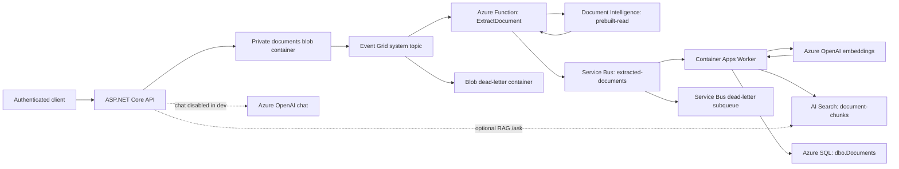

# DocIntake deployment, architecture, and verification

Status date: **22 October 2026**. Environment: **development**.

This document describes the implemented repository and the Azure results shared
during deployment testing. It is not a fresh live inventory or a production
readiness certification. "Confirmed" means supported by the supplied deployment,
CLI, log, or SQL evidence; "pending" means a check has been proposed but its
successful result has not been supplied.

Topic documentation is organized into [architecture](../architecture/architecture-overview.md),
[development](implementation-status.md), and
[product](../product/mvp-definition.md). This report retains the deployment evidence.

## 1. Current outcome

The small-document ingestion path has reached a successful SQL metadata write.
The supplied SQL screenshot shows:

| Field | Observed value |
|---|---|
| Document ID | `6debfb11-d680-48f6-ac64-3973276b8869` |
| Chunk count | `1` |
| Indexed at | `2026-10-22 12:58:58.6803004` |
| Source | Original document Blob Storage URL |

The Worker writes metadata after embeddings and successful Search upload.
Consequently, this row is strong evidence of execution across the ingestion
pipeline. A direct Search query and confirmation of message completion are
still required to close out verification for this particular upload.

This does **not** establish large-document support, chat functionality, load
capacity, disaster recovery, or production network isolation.

## 2. Implemented architecture



### Request and processing flow

1. The client obtains an Entra access token for the API.
2. `POST /documents` accepts one validated PDF or DOCX multipart `file`.
3. The API assigns a GUID, stores the original under
   `documents/<document-id>/<sanitized-file-name>`, and returns HTTP 202 with
   `{ "documentId": "<guid>", "status": "queued" }`.
4. Blob creation matches the Event Grid subscription and invokes
   `ExtractDocument`.
5. The Function validates the event source and uses Document Intelligence
   `prebuilt-read` to extract text.
6. The Function sends the shared `DocumentMessage` JSON contract:
   `sourceUrl`, `documentId`, and inline `content`. Message ID is the document ID.
7. The Worker splits text into 800-character chunks with 100-character overlap,
   generates embeddings, and uploads deterministic Search IDs
   `<document-id>-<chunk-index>`.
8. After Search upload succeeds, the Worker upserts SQL metadata and completes
   the Service Bus message.

HTTP 202 acknowledges storage/acceptance, not completed extraction or indexing.
The returned `Location` header is not a working status API:
`GET /documents/{id}` is not implemented.

### Failure and replay behavior

- Event Grid retries failed extraction/delivery; exhausted delivery can reach
  the private `eventgrid-deadletter` blob container.
- Worker processing uses PeekLock, explicit settlement, and lock renewal.
  Repeated indexing failures reach the Service Bus dead-letter subqueue with
  `IndexingFailed` and an exception description. Invalid contracts use
  `InvalidDocumentMessage`; the broker can also dead-letter exhausted deliveries.
- Search writes and SQL writes are not one distributed transaction. Search may
  contain chunks even when SQL fails.
- Deterministic Search keys and the SQL transactional upsert support redelivery
  of the same document. Re-uploading a file assigns a new document ID; it is not
  file-content deduplication.
- Documents with no extractable text are logged and skipped without a SQL row.

Implementation: [Extractor](../../src/DocIntake.Extractor/ExtractDocument.cs),
[Worker](../../src/DocIntake.Worker/IngestionWorker.cs),
[indexer](../../src/DocIntake.Worker/ChunkIndexer.cs),
[SQL repository](../../src/DocIntake.Worker/DocumentMetadataRepository.cs).

## 3. Technology stack

| Area | Implementation |
|---|---|
| Language/runtime | C#, .NET 8 |
| API | ASP.NET Core minimal APIs, JWT bearer authentication, multipart validation |
| Extraction host | Azure Functions v4, .NET isolated worker, Event Grid trigger |
| Background processing | .NET Generic Host / BackgroundService |
| Azure authentication | Azure.Identity `DefaultAzureCredential`, managed identities |
| Data access | Azure SDKs; Microsoft.Data.SqlClient with Entra access-token callback |
| AI | Document Intelligence extraction, Azure OpenAI embeddings, partial RAG scaffolding |
| Search | Azure.Search.Documents SDK; HNSW vector index |
| Telemetry | Application Insights, Azure Monitor OpenTelemetry, Functions telemetry integration |
| Packaging | Docker for API/Worker; published ZIP for Extractor |
| Infrastructure | Bicep and environment-specific Bicep parameters |
| CI/CD | Azure DevOps YAML, Ubuntu hosted agent, Azure CLI, Bash |
| Tests | xUnit, FluentAssertions, Moq, ASP.NET Core test hosting, coverlet |

The Extractor pins `Microsoft.ApplicationInsights.WorkerService` to **2.23.0**.
The Functions integration currently uses Application Insights 2.x components;
independently upgrading WorkerService to 3.2.0 caused the observed
`ITelemetryInitializer` type-load crash.

Exact package versions are maintained in the
[API](../../src/DocIntake.Api/DocIntake.Api.csproj),
[Extractor](../../src/DocIntake.Extractor/DocIntake.Extractor.csproj),
[Worker](../../src/DocIntake.Worker/DocIntake.Worker.csproj), and
[test](../../tests/DocIntake.Tests/DocIntake.Tests.csproj) project files.

## 4. Azure services and infrastructure

Resource group: `rg-ai200-doc-intake-dev`.
Most resource names derive from prefix `di-dev-yoix3ptcm6eqg`.
Except for explicit overrides, location follows the resource-group location;
query Azure for actual regional placement rather than assuming all services
are in the SQL region.

| Service | Resource / configuration | Purpose |
|---|---|---|
| Container Apps environment | Consumption workload profile; shared environment | Hosts API and Worker |
| API Container App | `di-dev-yoix3ptcm6eqg-api`; production replicas 1-3 | HTTPS API, port 8080, TCP startup/liveness/readiness probes |
| Worker Container App | `di-dev-yoix3ptcm6eqg-worker`; replicas 0-5 | Queue-driven ingestion; no ingress or HTTP probes |
| Container resources | 0.5 CPU and 1 GiB per API/Worker replica | Current module defaults |
| Container Registry | `didevyoix3ptcm6eqgacr`; Basic; admin credentials disabled | Stores API/Worker build-ID-tagged images |
| Function App | `didevyoix3ptcm6eqgextractor` | Hosts `ExtractDocument` |
| Functions plan | Flex Consumption FC1, .NET isolated 8.0, 2048 MiB, maximum 40 instances | No always-ready instances configured |
| Storage | `didevyoix3ptcm6eqg`; Standard LRS; shared-key access disabled | Original files, Functions storage, deployment packages, Event Grid dead letters |
| Blob containers | `documents`, `extractor-packages`, `eventgrid-deadletter`; private | Separate storage responsibilities |
| Event Grid | `di-dev-yoix3ptcm6eqg-storage-events` / `documents-to-extractor` | BlobCreated delivery for the documents container |
| Service Bus | `di-dev-yoix3ptcm6eqg-messaging`; Standard; local auth disabled | `extracted-documents` queue |
| Queue configuration | 1-minute lock, max delivery count 5, duplicate detection window 10 minutes | Delivery/retry controls |
| Document Intelligence | `didevyoix3ptcm6eqgdi`; S0; local auth disabled | Text extraction |
| Azure OpenAI | `didevyoix3ptcm6eqgoai`; S0; local auth disabled | Embeddings and optional chat |
| Embedding deployment | `text-embedding-3-small`, model version 1, Standard capacity 30 | 1536-dimensional vectors; capacity is in thousands of tokens/minute |
| AI Search | `di-dev-yoix3ptcm6eqg-search`; Basic; one replica/partition; local auth disabled | `document-chunks` index |
| Azure SQL | `di-docintake-dev-sql-wus3-20261021`, West US 3; `docintake`, Basic | `dbo.Documents` metadata |
| Key Vault | `di-dev-yoix3ptcm6eqg-kv`; RBAC configuration in template | Search-query-key demonstration secret; runtime Search access uses Entra |
| Application Insights | `di-dev-yoix3ptcm6eqg-ai` | Request, exception, and application telemetry |
| Log Analytics | `di-dev-yoix3ptcm6eqg-logs`; 30-day configured retention | Container console/system logs and workspace telemetry |
| Consumption budget | Configured amount 50; email thresholds 80% and 100% | Advisory budget, not a spending cap |
| Microsoft Entra ID | API app registration, admin group, managed identities | API authentication and service authorization |

### Identity and access boundaries

- API: system identity for Blob Storage and other configured service roles.
  Production authentication bypass is disabled.
- Extractor: system identity for host/package storage, document blobs,
  Document Intelligence, and Service Bus sending.
- Worker: system identity for Service Bus receiving/scaling, Search index
  administration/data access, embeddings, and SQL authentication.
- Worker image pulls: dedicated user-assigned `<prefix>-worker-pull` identity
  with AcrPull assigned before Worker provisioning.
- Event Grid system-topic identity: Storage Blob Data Contributor at storage
  account scope for dead-letter authorization. This access is broader than a
  single container.
- SQL access also requires a contained Worker database user and database roles.
  Azure resource Contributor/Owner does not grant database access.
- Target SQL administrator is the `DocIntake-Sql-Admins` Entra group. Membership
  and the actual server administrator/authentication state must be verified in
  Azure; past troubleshooting found drift to an individual guest administrator
  and Entra-only authentication disabled.

### SQL network configuration

The template defaults `allowAzureServicesToSql` to `false`; development
parameters explicitly enable it. This creates `AllowAzureServices`, with both
firewall endpoints `0.0.0.0`, Azure SQL's special Azure-services rule.

It permits connection attempts from Azure resources **outside this subscription
as well**. Authentication and database authorization remain required. It was
chosen for development after observed Worker egress IPs changed across attempts.
It is not restricted production networking.

Incremental deployment does not delete an existing conditional resource when
its condition becomes false. To revoke this access, disable the parameter and
explicitly remove the deployed firewall rule. Temporary individual-IP rules
are also not automatically removed.

Sources: [main template](../../infra/main.bicep),
[parameters](../../infra/main.bicepparam),
[Container App module](../../infra/modules/containerApp.bicep).

## 5. Deployment process and operational prerequisites

The [pipeline](../../infra/azure-pipelines.yml) performs:

1. Install .NET 8; Release build with warnings as errors; solution tests.
2. Optional first-time infrastructure bootstrap.
3. Authenticate Docker to ACR, build/push API and Worker on the agent.
4. Deploy application infrastructure with real images.
5. Publish/package/deploy Extractor using Flex-aware ZIP deployment.
6. Poll ARM `properties.state` for Running and list functions for
   `ExtractDocument`: 30 attempts with 10-second waits, plus command duration.
7. Redeploy with Event Grid enabled only after readiness passes.

Normal releases use **`provisionInfrastructure=false`**. Bootstrap is only for
an empty environment: it uses a public sample API image and can replace a
working API if rerun. A later SQL failure previously left that sample deployed.

The checked-in parameters contain bootstrap defaults and an empty Worker image.
Pipeline scripts override those values. Manual full-template deployments must
preserve real API/Worker image values and the intended bootstrap flags.

Prerequisites not fully automated by the pipeline:

- Entra API registration, delegated scope/client consent, administrator group
  membership, service connection setup, provider registration, quota approval.
- Service connection permissions for resource deployment, role assignments,
  identity assignment, and ACR push.
- SQL schema and contained Worker user/role grants from
  [schema.sql](../../sql/schema.sql), executed by an authorized database administrator.
- SQL authentication transitions for an existing server: inline
  `azureADOnlyAuthentication: true` updates previously failed. No dedicated
  existing-server migration has been implemented; verify Entra connectivity and
  actual authentication state before changes.

Deployment scripts:
[infrastructure/images](../../scripts/deploy-azure.sh),
[Extractor/Event Grid](../../scripts/deploy-extractor.sh).

## 6. Verification performed

| Verification | Evidence/result | Status |
|---|---|---|
| Pipeline build and tests | Shared green pipeline screenshot, including deployment tasks | Confirmed for the supplied run; not a new suite execution |
| API token acquisition | Cloud Shell default credential rejected custom MSI audience; interactive API-scope login followed by accepted upload | Confirmed upload authentication path |
| Invalid authentication | Upload without a usable token returned 401 | Confirmed negative authentication case |
| Valid document upload | Multiple HTTP 202 responses with GUID and queued status | Confirmed |
| Extractor indexing/startup | Initial empty function list and telemetry crash; 2.23.0 dependency fix followed by Event Grid activation and extraction attempts | Confirmed recovery for ingestion |
| Large extracted text | Function threw "does not fit in a Service Bus message" | Confirmed limitation, not a passing case |
| Event Grid to Extractor | Function invocation logs for uploaded documents | Confirmed |
| Service Bus publishing | Active messages observed; later Worker processing/dead letters | Confirmed |
| KEDA activation | Revision 0000008 scaled 0 to 1 for Service Bus, image tag 33 started, later scaled to zero | Confirmed for that historical revision |
| Worker namespace mismatch | Startup exception; corrected deployment variables supplied | Fix implemented; later SQL attempts prove execution passed startup |
| SQL networking failure | Dead letters contained SqlException with blocked outbound IPs | Confirmed diagnosis |
| Successful SQL persistence | Supplied row with one chunk after firewall change | Confirmed for one small document |
| Embeddings and Search upload | Both precede the successful metadata write in Worker code | Supported indirectly by SQL result; direct Search inspection pending |
| Final Service Bus completion | No post-success queue settlement evidence supplied | Pending |
| Earlier dead-letter recovery | Six failures previously observed | Pending; latest backlog size unknown |
| Extractor regression tests | Prior local targeted run: 9 passed; publish/dependency metadata verified | Historical local validation, not rerun for this document |
| Infrastructure checks | Prior compilation and ARM assertions for Worker settings/firewall | Historical validation, not a live drift check |

Earlier full/targeted test counts are point-in-time results, not a statement of
the current total test count. No new tests or Azure operations were executed
solely to create this documentation.

### Issues addressed during deployment

| Issue | Implemented resolution / operational action |
|---|---|
| Functions Y1 quota unavailable | Flex Consumption configuration, not a SKU-only substitution |
| Chat model quota unavailable | Optional chat deployment; disabled in development; embeddings retained |
| ACR Tasks unavailable | Docker build/push on pipeline agent |
| Private-image identity ordering | API bootstrap without registry auth; dedicated Worker image-pull identity |
| Unsupported scaler metadata | Managed identity configured on `custom.identity`, not `useManagedIdentity` metadata |
| Worker publish missing NuGet files | Docker publish stage inherits build stage |
| Empty Function app state check | ARM state query and bounded indexing wait |
| Functions telemetry type-load failure | WorkerService pinned to compatible 2.23.0 |
| Event Grid dead-letter authorization | Storage-account-scoped Blob Data Contributor |
| Worker configuration mismatch | Application namespace FQDN, `Sql__Server`, `Sql__Database`; scaler keeps bare namespace |
| Changing outbound IPs blocked SQL | Explicit development-only Azure-services firewall opt-in |
| SQL region/name provisioning conflicts | Independent SQL location/name parameters; current server in West US 3 |

## 7. Repeatable verification checklist

### API and ingestion

- [ ] Anonymous `/health` returns 200; this is liveness, not a dependency test.
- [ ] Anonymous protected endpoint returns 401.
- [ ] Authenticated valid PDF returns 202; record its new GUID.
- [ ] Missing multipart file returns 400; unsupported content/extension returns 415.
- [ ] Confirm original blob exists under the GUID prefix.
- [ ] Confirm extraction and Worker indexing logs for that GUID.

In Application Insights Logs:

```kusto
traces
| where timestamp > ago(2h)
| where message contains "<document-id>"
| project timestamp, cloud_RoleName, message
| order by timestamp asc
```

### Search and SQL

Connect to database `docintake` using an authorized Entra identity:

```sql
SELECT Id, SourceUrl, ChunkCount, IndexedAt
FROM dbo.Documents
WHERE Id = '<document-id>';
```

In AI Search, open `document-chunks` in Search explorer and use JSON query mode:

```json
{
  "search": "*",
  "filter": "source eq '<exact SourceUrl from SQL>'",
  "select": "id,source,content",
  "count": true
}
```

Verify count equals SQL ChunkCount, IDs follow the document/chunk pattern, and
content matches the test document. This is a content/index check, not a vector
retrieval-quality benchmark. The user needs Search Index Data Reader for reads.

### Queue settlement and troubleshooting

Cloud Shell Bash:

```bash
az servicebus queue show \
  --resource-group rg-ai200-doc-intake-dev \
  --namespace-name di-dev-yoix3ptcm6eqg-messaging \
  --name extracted-documents \
  --query countDetails --output json
```

Confirm no persistent active backlog or new dead-letter for the successful ID.
Old dead letters do not disappear automatically. Peek at
`DeadLetterReason`/`DeadLetterErrorDescription` before any replay; avoid exposing
message bodies containing document text.

Console attachment can fail when the Worker has zero replicas. Use the
environment's Log Analytics workspace for historical logs:

```kusto
ContainerAppConsoleLogs_CL
| where TimeGenerated > ago(2h)
| where ContainerAppName_s == "di-dev-yoix3ptcm6eqg-worker"
| project TimeGenerated, RevisionName_s, Log_s
| order by TimeGenerated asc
| take 200
```

Keep an evidence record of deployment/build ID, image tags, document ID,
timestamps, Search count, SQL row, and before/after queue counts. Never include
access tokens, keys, connection strings, or sensitive document content.

## 8. Limitations and remaining tasks

| Priority | Task / limitation | Completion criteria |
|---|---|---|
| High | Finish small-document verification | Direct Search result matches SQL ChunkCount; successful message settlement confirmed |
| High | Large-text claim-check design | Extracted text stored privately in Blob Storage; queue carries a validated reference; Worker retrieves it; identities, contracts, retries, cleanup, and tests updated |
| High | Recover earlier dead letters | Fix confirmed per error; replay one at a time; verify Search/SQL before removing originals; account for duplicate detection |
| High before production | Restricted SQL connectivity | Choose private networking/DNS or supported controlled-egress architecture, review cost/migration, remove broad Azure-services rule |
| High | Existing SQL authentication drift/migration | Verify group admin and Entra-only state; support repeat deployments without weakening authentication or losing admin access |
| Medium | Remove temporary firewall exceptions | Inventory/remove only obsolete named test rules after stable access is verified |
| Medium | Complete and activate Chat/RAG | Replace embedding/retrieval placeholders, implement grounded answers, obtain quota, then enable and verify `/ask`, citations, cost and safety |
| Medium | Document status API | Define/persist lifecycle and failure states; implement authorized status retrieval instead of unusable Location target |
| Medium | Empty-text UX | Define explicit no-text status instead of relying on warning and absent SQL row |
| Medium | Failure/cost alerts | Validate alerts for queue backlog, both dead-letter destinations, Worker failures, extraction errors, and budget notification delivery |
| Medium | Failure/replay testing | Prove retry/idempotency under lock loss, dependency failure, duplicate replay, and recovery; Search and SQL can diverge temporarily |
| Medium | Load/quota tests | Measure concurrent uploads, latency, embeddings TPM throttling, queue growth, scaling, service limits, and spend |
| Medium | Retention and recovery | Define original/extracted text retention, dead-letter cleanup, backup/restore tests, and sensitive-data handling |
| Medium | Bootstrap safeguards | Prevent accidental bootstrap against a populated environment and verify production image/ingress after deployment |

The inline queue payload is subject to Service Bus Standard's 256 KB message
limit including overhead; batch admission can reject it. PDF byte size does
not reliably predict serialized extracted-text size. Do not truncate text as a
silent workaround.

Chat is configured off (`deployChat=false`); a valid authenticated `/ask`
request is expected to return 503. RAG also contains placeholder embedding
result handling/retrieval, so enabling a model alone will not complete it.
Budgets are advisory, not enforcement.
Public service endpoints and account-level roles remain development trade-offs;
successful ingestion is not a security or production-readiness approval.

## 9. Related documentation

- [Project README](../../README.md)
- [Infrastructure template](../../infra/main.bicep)
- [Environment parameters](../../infra/main.bicepparam)
- [Pipeline](../../infra/azure-pipelines.yml)
- [SQL schema and grants](../../sql/schema.sql)
- [Cost guardrails](../runbooks/cost-guardrails.md)
